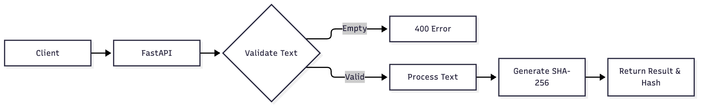
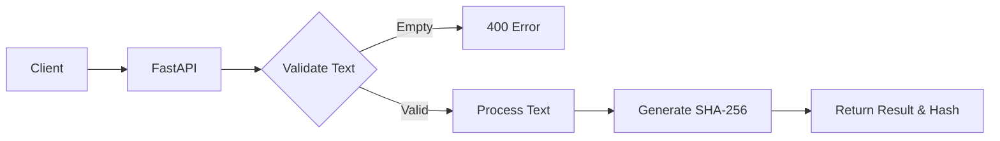

# EchoSift

Convert passive meeting audio into structured, searchable action items and summaries without active bot participation.

# Simple Query MVP

A minimal FastAPI service that processes text queries.

## Usage

Run the server:
uvicorn main:app --reload

Test it:
pytest -q

## Architecture

Mermaid source

